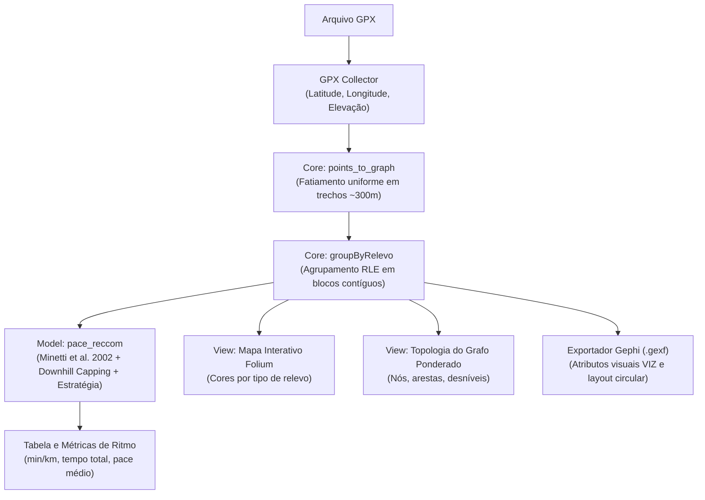

# 🏃 Pace Recommender By Route

O **Pace Recommender By Route** é uma aplicação em Python/Streamlit que analisa rotas de corrida considerando a **altimetria real e a inclinação do terreno**, combinando modelagem em **Grafos**, **Fisiologia do Exercício** e o conceito de **GAP (Grade Adjusted Pace)** para calcular e recomendar estratégias ótimas de ritmo (*pace*) por segmento de prova.

---

## 🎯 Por que o Pace Médio Tradicional Falha?

Calcular o ritmo de corrida apenas dividindo a distância total pelo tempo desejado é uma aproximação que ignora a física da locomoção humana:
* **🔺 Subidas:** Aumentam dramaticamente o custo metabólico (exigem mais Joules por metro). Manter o pace do plano em subidas leva à fadiga precoce por acúmulo de lactato.
* **🔻 Descidas:** Diminuem o custo aeróbico, mas introduzem impacto mecânico severo e contração muscular excêntrica (trabalho de frenagem). O ganho de velocidade precisa ser controlado para evitar lesões.
* **➖ Trechos Planos:** Permitem ritmo constante e progressão controlada ao longo da prova.

Este projeto decompõe o relevo em blocos homogêneos e calcula o ritmo compensado para cada subida, descida e trecho plano da rota.

---

## 🔬 Fundamentação Científica: O Modelo de Minetti et al. (2002) e o GAP

O ajuste de ritmo implementado baseia-se no mesmo fundamento científico utilizado pelas principais plataformas de análise esportiva (como o **GAP — Grade Adjusted Pace** do Strava):

> **Artigo:** *"Energy cost of walking and running at extreme uphill and downhill slopes"*  
> **Autores:** Alberto E. Minetti, Christian Moia, Giulio S. Roi, Davide Susta, Guido Ferretti  
> **Periódico:** *Journal of Applied Physiology*, 93(3): 1039-1046, 2002.  
> **DOI:** `10.1152/japplphysiol.01177.2001`

### 1. Polinômio de Custo Energético ($C_r$)
Através de testes empíricos com corredores em esteira submetidos a inclinações de **-45% a +45%**, medindo o consumo real de $\text{VO}_2$ e produção de $\text{VCO}_2$ por espirometria, Minetti et al. derivaram o custo energético da locomoção $C_r$ (em $\text{J} \cdot \text{kg}^{-1} \cdot \text{m}^{-1}$):

$$C_r(i) = 155.4 \cdot i^5 - 30.4 \cdot i^4 - 43.3 \cdot i^3 + 46.3 \cdot i^2 + 19.5 \cdot i + 3.6$$

Onde:
* $i$ é a fração decimal da inclinação do trecho (ex.: $+5\% \implies i = 0.05$; $-2\% \implies i = -0.02$).
* No plano ($i = 0$), o custo metabólico basal é a constante $C_r(0) = 3.6 \text{ J} \cdot \text{kg}^{-1} \cdot \text{m}^{-1}$.

### 2. Multiplicador de Ritmo por Esforço Constante
Para que o atleta mantenha o mesmo nível de consumo de oxigênio e esforço cardíaco durante toda a rota, o pace do trecho é ajustado pela razão de custos:

$$\text{Fator}(i) = \frac{C_r(i)}{C_r(0)} = \frac{C_r(i)}{3.6}$$

$$\text{Pace}_{\text{ajustado}} = \text{Pace}_{\text{plano}} \times \text{Fator}(i)$$

### 3. Trava de Frenagem em Descidas (*Downhill Capping*)
A física teórica prevê economia contínua em declives acentuados. Contudo, na prática biomecânica, declives fortes exigem **trabalho muscular excêntrico** dos quadríceps para absorção de impacto articular e estabilização postural.  
Por essa razão, o algoritmo limita a inclinação compensada em **-3%** para descidas, evitando projeções irreais de aceleração ou riscos de lesão para o corredor.

### 4. Estratégia de Prova
Além da equação de Minetti, o modelo aplica inteligência tática esportiva:
* **Aquecimento Inicial:** Moderação controlada no primeiro trecho (+4% de margem).
* **Progressão nos Planos:** Aceleração gradual (-1% acumulado a cada novo bloco plano).
* **Split Final:** Aceleração tática nos segmentos finais de prova.

---

## 📸 Demonstração Visual e Funcionalidades

A aplicação processa o arquivo `.GPX`, identifica a altimetria e renderiza mapas, métricas e análises topológicas:

<div align="center">
  
</div>

### 🌟 Principais Recursos
* ⏱️ **Seletor Intuitivo de Pace Alvo:** Entrada precisa de minutos e segundos (ex: `04:45 min/km`) com botão de confirmação e recálculo reativo.
* 🗺️ **Mapa Interativo (Folium/Leaflet):** Traçado georreferenciado colorido por relevo (Verde = Plano, Vermelho = Subida, Azul = Descida) com tooltips detalhadas.
* 📊 **Tabela Detalhada com Paces Recomendados:** Exibição clara de cada segmento com:
  * Trecho e Tipo de Relevo (ícone visual)
  * Distância individual (km e m)
  * Inclinação média (%)
  * **Pace Recomendado (min/km)** adaptado pelo modelo GAP
  * **Tempo Estimado (min)** de cada bloco
  * **Linha Totalizadora** com a somatória da prova, desníveis e pace médio geral resultante.
* 🕸️ **Visualização Topológica da Rota:** Plotagem direta na interface do grafo ponderado (`NetworkX` + `Matplotlib`), exibindo a sequência dos blocos, variação de altitude nas arestas e pesos do trajeto.
* 📥 **Exportação Pré-Formatada para o Gephi (.gexf):** Download imediato do arquivo GEXF enriquecido com extensões visuais (VIZ), cores RGBA personalizadas, nós geográficos e layout circular otimizado para circuitos fechados.

---

## 🏛️ Arquitetura do Projeto

O código é estruturado de forma desacoplada e modular:

```text
├── collectors/         # Ingestão e parsing de fontes de dados GPS
│   └── gpx_collector.py
├── core/               # Segmentação atômica (~300m) e agrupamento por RLE
│   └── graph_builder.py
├── models/             # Modelo matemático de recomendação de pace (GAP / Minetti)
│   └── pace_reccom.py
├── services/           # Orquestração do pipeline e exportação Gephi (.gexf)
│   └── route_services.py
├── views/              # Renderização de mapas (Folium) e topologia de grafos
│   └── chart_view.py
├── Enums/              # Enumerações tipadas (TipoRelevo, ColorByRelevo)
│   └── enum.py
├── utils/              # Funções matemáticas (Minetti, Haversine, formatação)
│   └── utils.py
├── assets/             # Imagens e diagramas da documentação
├── main.py             # Dashboard interativo Streamlit
└── requirements.txt    # Dependências do projeto
```

---

## ⚙️ Como Funciona o Pipeline



---

## 🚀 Como Executar Localmente

### 1. Clonar o repositório
```bash
git clone https://github.com/Felipe0132/Pace-Recommender-By-Route.git
cd Pace-Recommender-By-Route
```

### 2. Criar e ativar o ambiente virtual
```bash
python3 -m venv venv
source venv/bin/activate  # No Windows: venv\Scripts\activate
```

### 3. Instalar dependências
```bash
pip install -r requirements.txt
```

### 4. Executar a aplicação Streamlit
```bash
streamlit run main.py
```

---

## 🛠️ Tecnologias Utilizadas

* **Linguagem:** Python 3
* **Interface & Web:** Streamlit, Streamlit-Folium
* **Visualização Espacial e Grafos:** Folium, Leaflet, NetworkX, Matplotlib
* **Processamento de Dados GPS:** gpxpy, Pandas
* **Modelagem Fisiológica:** Algoritmo polinomial baseado em Minetti et al. (2002) / GAP
* **Análise de Redes:** Gephi (formato `.gexf` com extensões VIZ)

---

## 📚 Referências

* Minetti, A. E., Moia, C., Roi, G. S., Susta, D., & Ferretti, G. (2002). *Energy cost of walking and running at extreme uphill and downhill slopes*. **Journal of Applied Physiology**, 93(3), 1039-1046.
* Strava Engineering. *Grade Adjusted Pace (GAP)*. Strava Support & Science Documentation.
