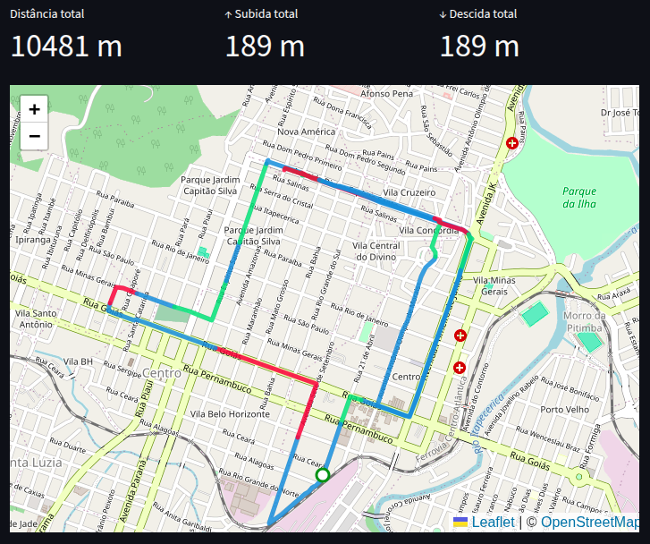

# 🏃 Pace Recommender By Route

O **Pace Recommender By Route** é uma aplicação em Python/Streamlit que analisa rotas de corrida considerando o **relevo e a altimetria real do terreno** para sugerir estratégias de ritmo (*pace*).

---

## 🎯 A Ideia do Projeto

Calcular o ritmo de um corredor apenas com base na **distância total** pode ser ilusório. Um percurso de 10 km completamente plano exige um esforço muito diferente do mesmo percurso com grandes subidas ou descidas acentuadas.

* **🔺 Subidas:** Exigem maior custo energético, demandando uma redução controlada do pace para evitar fadiga precoce.
* **🔻 Descidas:** Permitem ganhos de velocidade e menor impacto cardiovascular se executadas com técnica adequada.
* **➖ Trechos Planos:** Permitem estabilizar o ritmo de cruzeiro e recuperar a cadência.

Este projeto decompõe o trajeto e analisa as nuances do relevo para orientar o ritmo ideal em cada segmento da prova.

---

## 📸 Exemplo de Visualização e Métricas

A aplicação processa o arquivo `.gpx`, calcula os acumulados reais de subida/descida e renderiza o mapa interativo com código de cores por relevo:

<div align="center">
  
</div>

### 📊 Tabela de Detalhamento por Segmento

Após a consolidação dos trechos de mesmo relevo, o corredor tem acesso a uma tabela detalhada com as características de cada bloco:

| Trecho | Relevo | Distância | Inclinação Média |
| :--- | :--- | :--- | :--- |
| **Segmento #1** | ➖ Plano | 1.200 m | `+0.4%` |
| **Segmento #2** | 🔺 Subida | 900 m | `+5.8%` |
| **Segmento #3** | ➖ Plano | 600 m | `-0.2%` |
| **Segmento #4** | 🔻 Descida | 1.500 m | `-6.1%` |
| **Segmento #5** | ➖ Plano | 800 m | `+0.8%` |

---

## 🏛️ Nova Arquitetura Modular

O projeto foi totalmente refatorado para seguir uma arquitetura em camadas desacopladas, facilitando a adição de novas fontes de dados (GPX, cliques manuais no mapa, Strava, etc.):

```text
├── collectors/      # Ingestão e extração de dados brutos (GPX, cliques, etc.)
│   └── gpx_collector.py
├── core/            # Regras de negócio puras (segmentação ~300m e agrupamento RLE)
│   └── graph_builder.py
├── services/        # Orquestração do pipeline completo
│   └── route_services.py
├── views/           # Renderização de mapas no Folium e gráficos
│   └── chart_view.py
├── Enums/           # Constantes tipadas (TipoRelevo, ColorByRelevo)
│   └── enum.py
├── utils/           # Funções matemáticas puras (Haversine, Altimetria)
│   └── utils.py
├── assets/          # Imagens e capturas de tela para documentação
└── main.py          # Interface Streamlit limpa e reativa
```

---

## ⚙️ Como Funciona o Pipeline

1. **Coleta (`collectors`):** Lê o arquivo GPX e extrai a lista padronizada de pontos com coordenadas e elevação: `[{lat, lng, elev}, ...]`.
2. **Segmentação Atômica (`core.points_to_graph`):** Percorre a rota fatiando em blocos uniformes de ~300m, calculando distâncias via Haversine, ganho/perda de elevação e inclinação percentual.
3. **Consolidação por Relevo (`core.groupByRelevo`):** Agrupa arestas consecutivas de mesmo relevo em blocos contíguos (*Run-Length Encoding*), gerando as super-arestas para a estratégia de pace.
4. **Visualização (`views`):** Renderiza o mapa interativo no Folium com cores correspondentes a cada tipo de relevo e tooltips informativos.

---

## 🚀 Como Executar Localmente

### 1. Clonar o repositório
```bash
git clone https://github.com/Felipe0132/Pace-Recommender-By-Route.git
cd Pace-Recommender-By-Route
```

### 2. Criar e ativar o ambiente virtual
```bash
python3 -m venv venv
source venv/bin/activate  # No Windows: venv\Scripts\activate
```

### 3. Instalar dependências
```bash
pip install -r requirements.txt
```

### 4. Executar a aplicação Streamlit
```bash
streamlit run main.py
```

---

## 🛠️ Tecnologias Utilizadas
* **Python 3**
* **Streamlit & Streamlit-Folium** (Interface web reativa e mapas interativos)
* **Folium & Leaflet** (Mapas geoespaciais coloridos por relevo)
* **NetworkX** (Estruturas de grafos e super-arestas)
* **gpxpy** (Leitura e decodificação precisa de tracks GPS)
* **Pandas** (Estruturação e exibição tabular das métricas)

