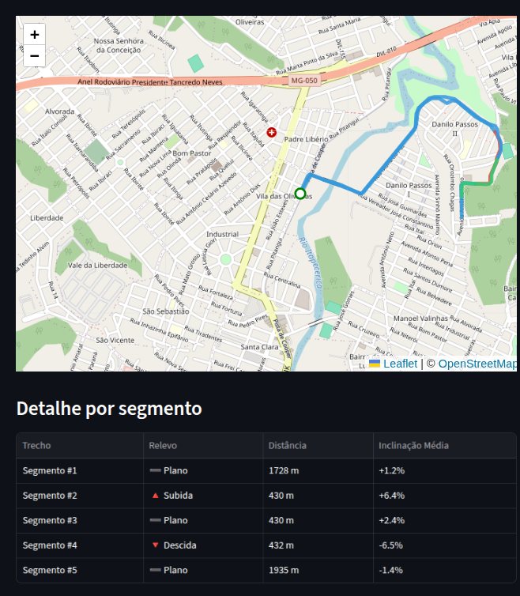
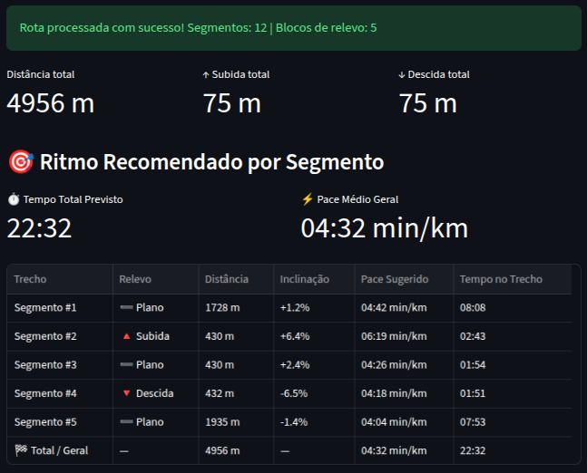
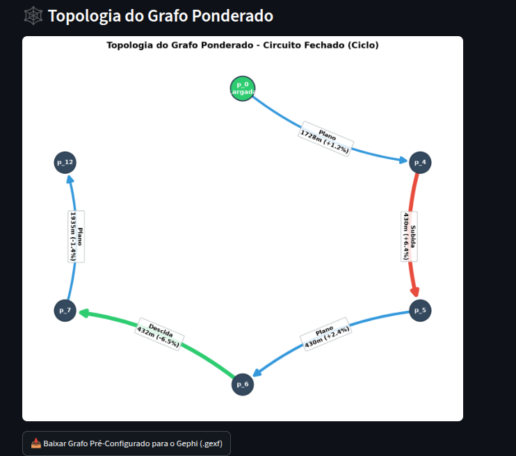
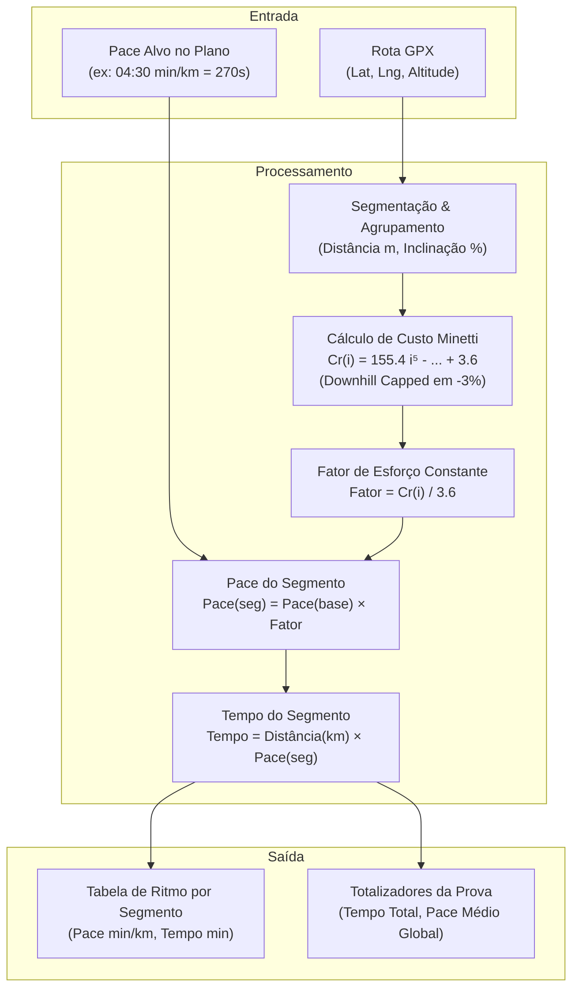

# 🏃 Pace Recommender By Route

O **Pace Recommender By Route** é uma aplicação em Python e Streamlit projetada para corredores, treinadores e atletas de endurance. Ela analisa arquivos GPS (`.gpx`), modela a rota como um **grafo direcionado ponderado**, avalia a topologia e a altimetria real do percurso e calcula recomendações personalizadas de **estratégia de ritmo (*pace*) por trecho**, fundamentadas na **Fisiologia do Exercício**, no conceito de **GAP (Grade Adjusted Pace)** e no modelo matemático de **Minetti et al. (2002)**.

---

## 🎯 Por que o Pace Médio Linear Falha?

Planejar uma prova com base apenas no ritmo médio linear (dividir o tempo alvo pela distância total) é uma estratégia com alto risco fisiológico quando o percurso tem oscilações de relevo:

* **🔺 Subidas:** O trabalho mecânico positivo contra a gravidade eleva bruscamente o custo de oxigênio ($\text{VO}_2$). Tentar manter o pace plano em subidas recruta fibras musculares de contração rápida (tipo II), acumulando lactato e esgotando rapidamente as reservas de glicogênio.
* **🔻 Descidas:** O custo cardiovascular diminui, mas o trabalho muscular **excêntrico** (freio e absorção de impacto articular) sobrecarrega os quadríceps e a tíbia. Aumentar a velocidade sem controle resulta em fadiga neuromuscular precoce e alto risco de lesão.
* **➖ Trechos Planos:** Permitem cadência estável e ritmos progressivos planejados.

Este projeto fatiará a rota em segmentos contíguos de mesmo relevo, indicando exatamente quando dosar energia nas subidas, quando acelerar com segurança nas descidas e como progredir no plano para atingir o tempo total desejado com eficiência metabólica constante.

---

## 📸 Demonstração da Aplicação

### 1. Mapa Interativo e Detalhamento da Rota
A rota GPX é dividida em blocos de relevo homogêneos (Plano, Subida, Descida), visualizados em um mapa interativo Leaflet/Folium e catalogados com extensão e inclinação percentual:

<div align="center">
  
</div>

---

### 2. Ritmo Recomendado por Segmento e Métricas Totais
Ao definir o pace base no plano (ex: 04:30 min/km), o sistema calcula o pace sugerido e o tempo estimado de cada bloco, além da somatória completa de prova:

<div align="center">
  
</div>

---

### 3. Topologia do Grafo Ponderado & Exportação para o Gephi
A rota é modelada matematicamente como um grafo direcionado, identificando se o percurso é linear ou circuito fechado (ciclo), exibindo nós, distâncias, desníveis e permitindo exportação `.gexf` para o **Gephi**:

<div align="center">
  
</div>

---

## 🔬 Fundamentação Científica: O Modelo de Minetti et al. (2002)

O motor de cálculo do ritmo baseia-se no estudo de referência internacional em biomecânica e fisiologia do exercício:

> **Artigo:** *"Energy cost of walking and running at extreme uphill and downhill slopes"*  
> **Autores:** Alberto E. Minetti, Christian Moia, Giulio S. Roi, Davide Susta e Guido Ferretti  
> **Publicação:** *Journal of Applied Physiology*, 93(3): 1039-1046, 2002.  
> **DOI:** `10.1152/japplphysiol.01177.2001`  
> *(Modelo adotado como padrão-ouro em plataformas esportivas como o Strava para o **GAP — Grade Adjusted Pace**).*

---

### 1. O Conceito de Custo Energético da Locomoção ($C_r$)

O custo de transporte na corrida ($C_r$) mede a quantidade de energia metabólica necessária para deslocar 1 quilograma de massa corporal por 1 metro de distância horizontal:

$$C_r = \frac{\dot{V}\text{O}_2 \times \text{equivalente calórico}}{\text{velocidade}} \quad \left[\text{J} \cdot \text{kg}^{-1} \cdot \text{m}^{-1}\right]$$

Em terreno plano, o custo de transporte do ser humano na corrida independe amplamente da velocidade na faixa submáxima, situando-se próximo a uma constante empírica:

$$C_r(0) \approx 3.6 \text{ J} \cdot \text{kg}^{-1} \cdot \text{m}^{-1}$$

---

### 2. O Polinômio de 5º Grau de Minetti

Para avaliar o comportamento fisiológico em relevos extremos, Minetti e sua equipe colocaram corredores treinados em esteiras motorizadas submetidas a gradientes entre **-45% (declive extremo)** e **+45% (aclive extremo)**, monitorando as trocas gasosas respiratórias em tempo real por espirometria.

O ajuste empírico ótimo dos dados resultou em um polinômio de 5º grau:

$$C_r(i) = 155.4 \cdot i^5 - 30.4 \cdot i^4 - 43.3 \cdot i^3 + 46.3 \cdot i^2 + 19.5 \cdot i + 3.6$$

Onde $i$ é a inclinação da superfície expressa em fração decimal:
* Subida de $+6.4\% \implies i = +0.064$
* Descida de $-6.5\% \implies i = -0.065$
* Terreno plano ($0.0\%$) $\implies i = 0.0$

#### Interpretação dos Termos Matemáticos:
* **$3.6$ (Constante Basal):** Custo de locomoção no plano.
* **$+19.5 \cdot i$ (Gradiente Linear):** Resposta imediata para variações suaves de relevo ($\pm 1\%$ a $\pm 3\%$).
* **$+46.3 \cdot i^2 - 43.3 \cdot i^3 - 30.4 \cdot i^4 + 155.4 \cdot i^5$ (Não Linearidade e Assimetria):** Captura a assimetria fisiológica radical entre subidas e descidas:
  * Em subidas fortes ($i > 0.10$), o termo $155.4 \cdot i^5$ cresce de forma exponencial, refletindo o custo extremo de gerar trabalho concêntrico contra a força gravitacional ($W = m \cdot g \cdot h$).
  * Em descidas, a gravidade fornece energia potencial, reduzindo temporariamente a exigência de oxigênio.

---

### 3. A Trava de Frenagem em Descidas (*Downhill Capping* a -3%)

Embora a curva termodinâmica continue indicando economia em descidas de até $-15\%$, a corrida ao ar livre não opera em condições puramente ideais de laboratório:

1. **Contração Muscular Excêntrica:** Para evitar acelerar até a perda de controle ou queda, os quadríceps e a musculatura da panturrilha atuam como freios (*braking force*), contraindo-se em extensão.
2. **Impacto e Força de Reação do Solo:** Cada passada em descida acentuada gera picos de impacto que causam microrrupturas nas miofibrilas musculares e sobrecarga nos tendões patelares.

Por isso, o sistema implementa uma trava fisiológica:

$$i_{\text{ajustado}} = \max(i, -0.03)$$

Ou seja, mesmo em declives de $-6.5\%$ ou mais severos, o algoritmo calcula o ritmo assumindo no máximo $-3.0\%$ de auxílio gravitacional, evitando recomendar velocidades que causariam esgotamento muscular ou lesões.

---

### 4. Passo a Passo Algorítmico do Cálculo



1. **Determinação da Inclinação:**  
   $$i = \frac{\Delta \text{altitude (m)}}{\text{distância (m)}}$$
2. **Avaliação do Custo Relativo:**  
   $$\text{Fator}(i) = \frac{C_r(i)}{C_r(0)} = \frac{C_r(i)}{3.6}$$
   - Se $\text{Fator} > 1.0$ (Subida): O ritmo deve ser mais lento em proporção direta ao esforço.
   - Se $\text{Fator} < 1.0$ (Descida suave): O ritmo pode ser mais rápido mantendo o mesmo $\text{VO}_2$.
3. **Pace Ajustado do Trecho:**  
   $$\text{Pace}_{\text{trecho}} (\text{s/km}) = \text{Pace}_{\text{base}} (\text{s/km}) \times \text{Fator}(i)$$
4. **Tempo Estimado do Bloco:**  
   $$T_{\text{bloco}} (\text{s}) = \left(\frac{\text{Distância (m)}}{1000}\right) \times \text{Pace}_{\text{trecho}} (\text{s/km})$$
5. **Tempo e Pace Médio Global da Prova:**  
   $$\text{Tempo Total} = \sum_{k=1}^N T_{\text{bloco}, k}, \qquad \text{Pace Médio Global} = \frac{\text{Tempo Total}}{\text{Distância Total (km)}}$$

---

### 5. Inteligência Tática e Gestão de Prova

Nos trechos planos, o modelo aplica modulação tática clássica de periodização de prova:
* **Aquecimento Inicial:** No primeiro segmento plano da rota, é aplicada uma retenção leve ($+4\%$ no pace) para adaptação cardiorrespiratória e vascular.
* **Progressão nos Planos:** A cada novo trecho plano concluído, o ritmo é progressivamente intensificado ($-1\%$ acumulado), simulando um *negative split*.
* **Sprint Final:** Nos últimos blocos de prova, o ritmo base é reduzido em até $10\%$ para esgotamento final planejado.

---

## 🏛️ Arquitetura do Repositório

O projeto adota uma estrutura em camadas, com separação estrita de responsabilidades:

```text
├── collectors/         # Leitura e parsing de dados de GPS (.gpx)
│   └── gpx_collector.py
├── core/               # Regras de negócio puras: segmentação atômica (~300m) e agrupamento RLE
│   └── graph_builder.py
├── models/             # Modelos fisiológicos: Minetti et al. e estratégias de ritmo
│   └── pace_reccom.py
├── services/           # Orquestração do pipeline e exportação para Gephi (.gexf)
│   └── route_services.py
├── views/              # Camada de apresentação gráfica: mapas Folium e grafos NetworkX
│   └── chart_view.py
├── Enums/              # Enumerações tipadas (TipoRelevo, ColorByRelevo)
│   └── enum.py
├── utils/              # Funções matemáticas puras (Haversine, Minetti, conversão de tempo)
│   └── utils.py
├── assets/             # Imagens e capturas de tela da documentação
├── main.py             # Aplicação Streamlit interativa e reativa
└── requirements.txt    # Dependências do projeto
```

---

## 🚀 Como Executar Localmente

### 1. Clonar o repositório
```bash
git clone https://github.com/Felipe0132/Pace-Recommender-By-Route.git
cd Pace-Recommender-By-Route
```

### 2. Criar e ativar o ambiente virtual
```bash
python3 -m venv venv
source venv/bin/activate  # No Windows: venv\Scripts\activate
```

### 3. Instalar dependências
```bash
pip install -r requirements.txt
```

### 4. Executar a aplicação
```bash
streamlit run main.py
```

---

## 🛠️ Tecnologias Utilizadas

* **Linguagem:** Python 3
* **Interface Web Reativa:** Streamlit, Streamlit-Folium
* **Renderização Geoespacial:** Folium, Leaflet
* **Estrutura de Redes & Grafos:** NetworkX, Matplotlib
* **Processamento de Dados Espaciais:** gpxpy, Pandas
* **Modelagem Fisiológica:** Polinômio de Minetti et al. (2002) / GAP
* **Análise de Redes Externa:** Gephi (exportador `.gexf` com metadados visuais VIZ)

---

## 📚 Referências Bibliográficas

* **Minetti, A. E., Moia, C., Roi, G. S., Susta, D., & Ferretti, G. (2002).** *Energy cost of walking and running at extreme uphill and downhill slopes*. **Journal of Applied Physiology**, 93(3), 1039-1046.
* **Margaria, R., Cerretelli, P., Aghemo, P., & Sassi, G. (1963).** *Energy cost of running with change of slope*. **Journal of Applied Physiology**, 18(2), 367-370.
* **Strava Engineering (2017).** *Grade Adjusted Pace (GAP)*. Strava Engineering & Data Science Publications.
