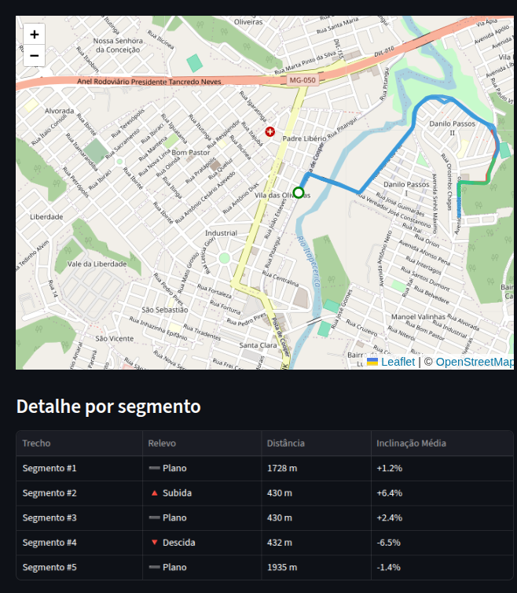
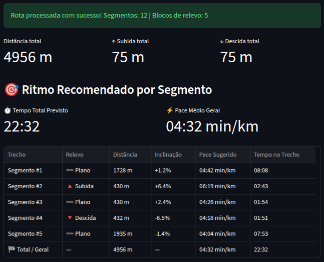
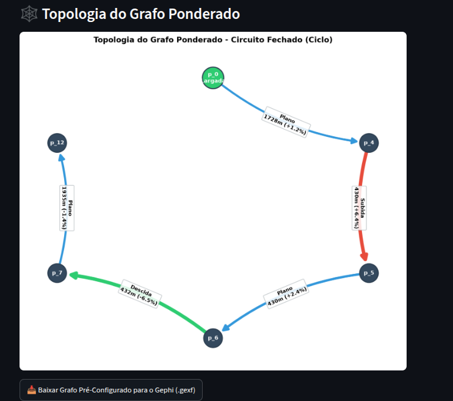
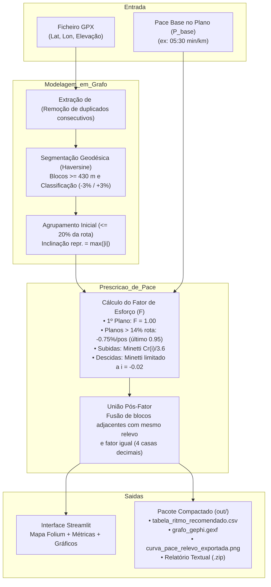

<div align="center">

# 🏃 Pace Recommender By Route

**Sistema de Recomendação de Pace com Parâmetros de Elevação Baseado em Grafos Direcionados e Custo Metabólico de Minetti**

[](https://www.python.org/)
[](https://streamlit.io/)
[](https://networkx.org/)
[](https://doi.org/10.5281/zenodo.23809922)
[](https://www.divinopolis.cefetmg.br/)

[Visão Geral](#-por-que-o-pace-médio-linear-falha) •
[Demonstração](#-demonstração-da-aplicação) •
[Modelagem Matemática](#-fundamentação-científica-e-modelagem-matemática) •
[Resultados](#-resultados-de-exemplo-rota-corrida-viveza) •
[Como Executar](#-como-executar-localmente)

</div>

---

O **Pace Recommender By Route** é uma aplicação em Python e Streamlit projetada para corredores, treinadores e atletas de endurance. Ela processa rotas GPS (`.gpx`), representa o percurso como um **grafo direcionado ponderado** $G = (V, E)$, classifica os blocos topográficos pela altimetria e prescreve uma **estratégia de ritmo (*pace*) por trecho**, fundamentada no conceito de **GAP (*Grade Adjusted Pace*)** e no polinómio de custo energético de **Minetti et al. (2002)**.

> [!NOTE]
> **Artigo Científico:** *Sistema de Recomendação de Pace com Parâmetros de Elevação*  
> **Autores:** Felipe Silva (`felipe.silva@aluno.cefetmg.br`) & Michel Pires da Silva (`michel@cefetmg.br`) — Departamento de Computação, CEFET-MG Campus V, Divinópolis, Brasil.

---

## 🎯 Por que o Pace Médio Linear Falha?

Na prática, o planeamento de prova costuma dividir a distância total em blocos (por exemplo, de 20% cada) e distribuir o *pace* entre eles com uma largada controlada e aceleração gradual. Essa divisão funciona bem em percursos planos, mas falha quando o trajeto apresenta variações de relevo, pois a mesma velocidade exige esforços fisiológicos muito diferentes conforme a inclinação:

* **🔺 Subidas (Aclives $\ge +3\%$):** O trabalho mecânico positivo contra a gravidade eleva de maneira não linear o custo energético. Tentar manter o *pace* plano em aclives gera desgaste metabólico precoce.
* **🔻 Descidas (Declives $< -3\%$):** O custo metabólico diminui, mas ocorrem alterações acentuadas nas forças de reação do solo e impacto excêntrico, exigindo um limite técnico de velocidade nas descidas.
* **➖ Trechos Planos ($-3\% \le \text{inclinação} < +3\%$):** Permitem sustentar o ritmo de referência e aplicar regras estruturadas de progressão ao longo da prova.

Enquanto o **GAP (*Grade Adjusted Pace*)** tradicional converte o *pace* realizado numa inclinação qualquer no *pace* equivalente em terreno plano, este trabalho explora o **sentido inverso como ferramenta de planeamento**: estimar um ritmo alvo por trecho a partir de uma referência em terreno plano.

---

## 📸 Demonstração da Aplicação

### 1. Mapa Interativo e Detalhamento da Rota
A rota GPX é dividida em macro-segmentos topográficos (Plano, Subida, Descida), renderizados num mapa interativo Leaflet/Folium e catalogados com distância, ganhos/perdas de elevação e inclinação representativa:

<div align="center">
  
</div>

### 2. Ritmo Recomendado por Segmento e Métricas Totais
Ao definir o *pace* base em terreno plano (ex.: `05:30 min/km`), o sistema calcula o fator de esforço relativo, o *pace* sugerido e o tempo estimado de cada bloco, além da linha totalizadora da prova:

<div align="center">
  
</div>

### 3. Topologia do Grafo Ponderado & Exportação para o Gephi
A rota é modelada como um grafo direcionado com vértices sintéticos nas fronteiras dos blocos topográficos, gerando gráficos de perfil altimétrico vs. ritmo (`out/imagens/curva_pace_relevo_exportada.png`) e permitindo a exportação em `.gexf` (`out/grafo_gephi.gexf`) para análise no **Gephi**:

<div align="center">
  
</div>

---

## 🔬 Fundamentação Científica e Modelagem Matemática

### 1. Extração GPX, Distância de Haversine e Segmentação ($\ge 430\text{ m}$)

O coletor lê a sequência de pontos de trilha (`<trkpt>`) do ficheiro GPX (latitude $\phi$, longitude $\lambda$ e elevação $z$), removendo pontos consecutivos cujos três valores sejam idênticos. A distância horizontal $d$ (em metros) entre pontos consecutivos é determinada pela **fórmula de Haversine** sobre os pares de coordenadas em radianos:

$$d = 2R \arcsin\left(\sqrt{\sin^2\left(\frac{\Delta\phi}{2}\right) + \cos(\phi_k)\cos(\phi_{k+1})\sin^2\left(\frac{\Delta\lambda}{2}\right)}\right)$$

onde $R \approx 6371\text{ km}$ representa o raio médio da Terra, $\Delta\phi = \phi_{k+1} - \phi_k$ e $\Delta\lambda = \lambda_{k+1} - \lambda_k$.

Como os pontos do GPX possuem espaçamento não uniforme, o algoritmo acumula a distância geodésica entre pontos consecutivos até atingir ou ultrapassar o limiar de **430 m**, fechando o bloco no primeiro ponto que alcança esse valor (um eventual trecho restante no final da rota também é mantido como bloco). Para cada bloco, calcula-se a inclinação fracionária $i$ e percentual $i_{\mathrm{pct}}$ pela diferença líquida de elevação ($\Delta z$) entre os seus extremos dividida pela distância acumulada $d$:

$$i = \frac{\Delta z}{d}, \qquad i_{\mathrm{pct}} = i \times 100$$

Cada aresta é classificada em três categorias topográficas:
* **Subida (Aclive):** $i_{\mathrm{pct}} \ge +3\%$
* **Descida (Declive):** $i_{\mathrm{pct}} < -3\%$
* **Plano:** $-3\% \le i_{\mathrm{pct}} < +3\%$

---

### 2. Contração de Arestas e Agrupamento de Blocos

Para simplificar a topologia da rede (*edge contraction*) e evitar micro-arestas redundantes, o agrupamento ocorre em duas fases:
1. **Agrupamento Inicial (Limite Estrutural de 20%):** Blocos adjacentes da mesma classe de relevo são agrupados desde que a soma das suas distâncias não ultrapasse **20% da distância total da rota**. Para cada grupo, a **inclinação representativa** é selecionada pelo **maior valor absoluto** ($\max \vert{}i\vert{}$) entre as inclinações dos blocos que o compõem, e não por uma média ponderada.
2. **União Pós-Fator:** Após a atribuição dos fatores de esforço, blocos adjacentes da mesma classe que tenham fatores iguais (com comparação arredondada a quatro casas decimais) são unidos. Essa etapa final pode resultar num bloco com extensão superior ao limite estrutural de 20% aplicado no agrupamento inicial.

---

### 3. Polinómio de 5ª Ordem de Minetti e Fator de Esforço ($F_e$)

Para avaliar o impacto da inclinação representativa $i$ de cada bloco, aplica-se o polinómio de quinta ordem de **Minetti et al. (2002)**, que estima o custo energético relativo $C_r(i)$ (em $\text{J}\cdot\text{kg}^{-1}\cdot\text{m}^{-1}$):

$$C_r(i) = 155,4 i^5 - 30,4 i^4 - 43,3 i^3 + 46,3 i^2 + 19,5 i + 3,6$$

Comparando o custo na inclinação $C_r(i)$ com o custo basal em terreno plano $C_r(0) = 3,6\text{ J}\cdot\text{kg}^{-1}\cdot\text{m}^{-1}$, define-se o fator de esforço relativo $F_e$ e o ritmo ajustado do segmento ($P_{\mathrm{seg}}$) a partir do *pace* base ($P_{\mathrm{base}}$):

$$F_e = \frac{C_r(i)}{C_r(0)} = \frac{C_r(i)}{3,6}, \qquad P_{\mathrm{seg}} = P_{\mathrm{base}} \times F_e$$

> [!TIP]
> **Recomendação de Uso:** Recomenda-se informar um *pace* base ligeiramente mais lento que a média alvo da prova, pois a adaptação do ritmo em aclives depende da inclinação dos blocos, enquanto os trechos planos podem progredir segundo as regras do modelo.

---

### 4. Regras de Prescrição e Calibração de Pace

A alocação de ritmo percorre os blocos ordenados e aplica quatro regras implementadas:

1. **Primeiro Trecho Plano:** O primeiro bloco classificado como plano recebe o fator $F = 1,0$ (`+0,0%`), correspondente ao *pace* base (sem acréscimo de aquecimento).
2. **Progressão em Trechos Planos (Limiar de 14% da Rota):** O código utiliza 70% do limite estrutural de 20%, equivalente a **14% da distância total da rota**. Blocos planos posteriores com extensão superior a esse limiar recebem um fator que reduz o *pace* em **0,75% por posição de trecho plano**, com fator mínimo de $0,95$. Blocos planos menores mantêm o fator do trecho plano anterior. Se houver mais de um bloco plano, o **último bloco plano** recebe ainda um fator adicional de $0,95$, respeitado o limite mínimo de $0,95$ (`-5,0%`).
3. **Ajuste em Aclives:** Em segmentos de subida ($i_{\mathrm{pct}} \ge +3\%$), o ritmo é multiplicado pelo fator $F_e$ calculado pelo polinómio de Minetti.
4. **Limite Aplicado às Descidas (*Downhill Capping* a -2%):** Antes de avaliar o polinómio, inclinações inferiores a **-2%** são limitadas a $-2\%$ ($i = -0,02$):

$$i_{\mathrm{ajustado}} = \max(i, -0,02)$$

Assim, para uma descida de $-6,5\%$, o cálculo de custo utiliza $-2\%$, limitando o ganho de velocidade estimado em descidas acentuadas (`-10,3%`).

---

### 5. Fluxograma da Pipeline Algorítmica



---

## 📊 Resultados de Exemplo: Rota "Corrida Viveza"

O processamento computacional da rota `in/Corrida_Viveza.gpx` (distância de **4.956 m**, ganho e perda acumulados de elevação de **75 m** cada) com *pace* base de **`05:30 min/km`** resultou em **7 segmentos**, tempo total estimado de **`27:29`** e *pace* médio estimado de **`05:32 min/km`** (`+0,9%`):

| Trecho | Relevo | Distância (m) | Inclinação representativa (%) | Ajuste / Esforço (%) | Pace sugerido | Tempo |
| :--- | :--- | :---: | :---: | :---: | :---: | :---: |
| **Segmento #1** | Plano | 862 | -0,3% | +0,0% | 05:30 min/km | 04:44 |
| **Segmento #2** | Plano | 865 | +1,2% | -0,8% | 05:27 min/km | 04:43 |
| **Segmento #3** | Subida | 430 | +6,4% | +39,4% | 07:39 min/km | 03:17 |
| **Segmento #4** | Plano | 430 | +2,4% | -0,8% | 05:27 min/km | 02:20 |
| **Segmento #5** | Descida | 432 | -6,5% | -10,3% | 04:55 min/km | 02:07 |
| **Segmento #6** | Plano | 863 | -1,3% | -2,2% | 05:22 min/km | 04:38 |
| **Segmento #7** | Plano | 1072 | -1,4% | -5,0% | 05:13 min/km | 05:36 |
| **Total / Geral** | — | **4956** | — | **+0,9%** | **05:32 min/km** | **27:29** |

<details>
<summary><b>🔍 Observação sobre o Segmento #7 (Clique para expandir)</b></summary>
<br>
A aplicação do limite estrutural de 20% (991 m) no agrupamento inicial não impede que blocos finais ultrapassem esse valor caso ocorra a junção posterior de blocos adjacentes de mesmo relevo e mesmo fator de esforço (arredondado a 4 casas decimais). Por esse motivo, o <b>Segmento #7</b> totaliza <b>1.072 m</b> com ajuste de <code>-5,0%</code>.
</details>

---

## 🏛️ Arquitetura do Repositório

```text
├── collectors/         # Leitura de pontos <trkpt> do GPX e remoção de duplicados consecutivos
│   └── gpx_collector.py
├── core/               # Segmentação (>= 430m), agrupamento (<= 20% rota, max |i|) e grafo NetworkX
│   └── graph_builder.py
├── models/             # Polinómio de Minetti et al. (2002), progressão plana e fusão pós-fator
│   └── pace_reccom.py
├── services/           # Orquestração da pipeline e exportação (.csv, .gexf, .png, .txt e .zip)
│   └── route_services.py
├── views/              # Renderização de mapas Folium, perfil altimétrico/pace e grafo ponderado
│   └── chart_view.py
├── Enums/              # Enumerações tipadas (TipoRelevo, ColorByRelevo)
│   └── enum.py
├── utils/              # Funções matemáticas puras (Haversine, Minetti, conversão de tempo)
│   └── utils.py
├── assets/             # Imagens e capturas de ecrã da documentação
├── in/                 # Ficheiros GPX de entrada (ex: Corrida_Viveza.gpx)
├── out/                # Resultados exportados (tabela_ritmo_recomendado.csv, grafo_gephi.gexf)
│   └── imagens/        # Gráficos gerados (curva_pace_relevo_exportada.png)
├── main.py             # Aplicação web interativa em Streamlit
└── requirements.txt    # Dependências do projeto
```

---

## 🚀 Como Executar Localmente

```bash
# 1. Clonar o repositório
git clone [https://github.com/Felipe0132/Pace-Recommender-By-Route.git](https://github.com/Felipe0132/Pace-Recommender-By-Route.git)
cd Pace-Recommender-By-Route

# 2. Criar e ativar o ambiente virtual
python3 -m venv venv
source venv/bin/activate  # No Windows: venv\Scripts\activate

# 3. Instalar as dependências
pip install -r requirements.txt

# 4. Executar a aplicação Streamlit
streamlit run main.py
```

---

## 🛠️ Tecnologias Utilizadas

| Camada | Tecnologias |
| :--- | :--- |
| **Linguagem & Core** | Python 3 |
| **Interface Web Reativa** | Streamlit, Streamlit-Folium |
| **Renderização Geoespacial** | Folium, Leaflet |
| **Teoria dos Grafos & Visualização** | NetworkX, Matplotlib, Gephi (`.gexf`) |
| **Processamento de Dados Espaciais** | gpxpy, Pandas |
| **Modelagem Fisiológica** | Polinómio de Minetti et al. (2002) / Grade Adjusted Pace (GAP) |

---

## 📚 Referências Bibliográficas e Citação

1. **Minetti, A. E., Moia, C., Roi, G. S., Susta, D., & Ferretti, G. (2002).** *Energy cost of walking and running at extreme uphill and downhill slopes*. **Journal of Applied Physiology**, vol. 93, no. 3, pp. 1039–1046.
2. **Johnson, E. C., et al. (2022).** *Uneven but conservative pacing is associated with performance during uphill and downhill running*. **International Journal of Sports Physiology and Performance**, vol. 17, no. 8, pp. 1179–1187.
3. **Gottschall, J. S., & Kram, R. (2005).** *Ground reaction forces during downhill and uphill running*. **Journal of Biomechanics**, vol. 38, no. 3, pp. 445–452.
4. **Silva, F., & Silva, M. P. (2026).** *Dataset para otimização de rotas de corrida e modelagem de esforço baseado em grafos*. **Zenodo**. DOI: [`10.5281/zenodo.23809922`](https://doi.org/10.5281/zenodo.23809922).

<details>
<summary><b>📌 Como citar este trabalho (BibTeX)</b></summary>

```bibtex
@inproceedings{silva2026pace,
  author    = {Silva, Felipe and Silva, Michel Pires da},
  title     = {Sistema de Recomenda{\c{c}}{\~a}o de Pace com Par{\^a}metros de Eleva{\c{c}}{\~a}o},
  school    = {CEFET-MG Campus V},
  address   = {Divin{\'o}polis, Brasil},
  year      = {2026},
  doi       = {10.5281/zenodo.23809922}
}
```
</details>
